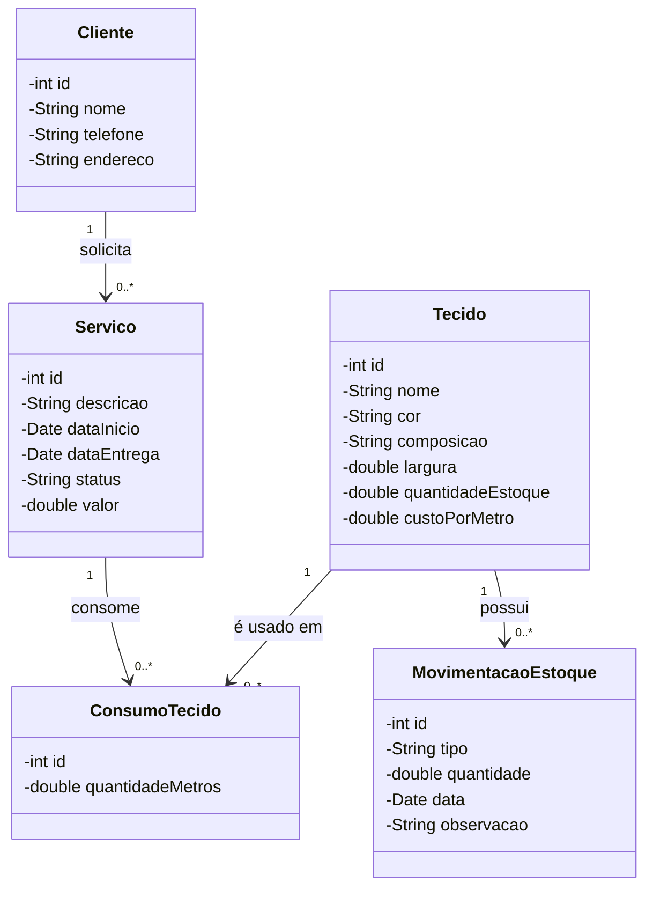
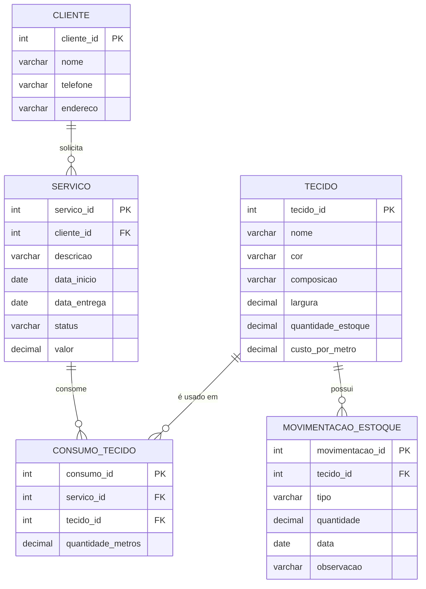

# CosturaControl

Sistema desktop em Java Swing para uma costureira controlar o estoque de tecidos, cadastrar clientes e acompanhar os serviços de costura realizados.

**Tecnologias:** Java Swing, padrão MVC (com DAO), banco de dados relacional (MySQL/PostgreSQL/SQLite).

## Funcionalidades

- Cadastro de tecidos com controle de quantidade em estoque (metros)
- Registro de entradas e saídas de tecido
- Cadastro de clientes
- Cadastro de serviços de costura e dos tecidos consumidos em cada um

## Diagrama de classes



## Diagrama MER



## Como executar

Requisitos: JDK 11 ou superior. O driver do SQLite já está em `lib/`, e o banco (`costura.db`) é criado sozinho na primeira execução.

- **Windows:** dê dois cliques em `executar.bat`
- **Linux/Mac:** `./executar.sh`
- **IDE (NetBeans/IntelliJ/Eclipse):** abra a pasta, marque `src` como pasta de código, adicione `lib/sqlite-jdbc-3.36.0.3.jar` às bibliotecas e execute a classe `Main`.

## Estrutura do projeto (MVC)

```
CosturaControl/
├── README.md
├── executar.bat / executar.sh
├── lib/sqlite-jdbc-3.36.0.3.jar
├── sql/schema.sql
└── src/
    ├── Main.java
    ├── model/       (entidades: Cliente, Tecido, MovimentacaoEstoque, Servico, ConsumoTecido)
    ├── view/        (telas Swing)
    ├── controller/  (validações e regras: recebe as ações da view e chama os DAOs)
    ├── dao/         (comandos SQL)
    └── database/    (conexão com o banco)
```

## Regras do sistema

- O estoque do tecido só muda por movimentações (entrada ou saída).
- Não é possível registrar saída maior que o estoque disponível.
- Ao adicionar um tecido a um serviço, o sistema dá baixa automática no estoque.
- Não é possível excluir cliente ou tecido que já esteja em uso em serviços.
